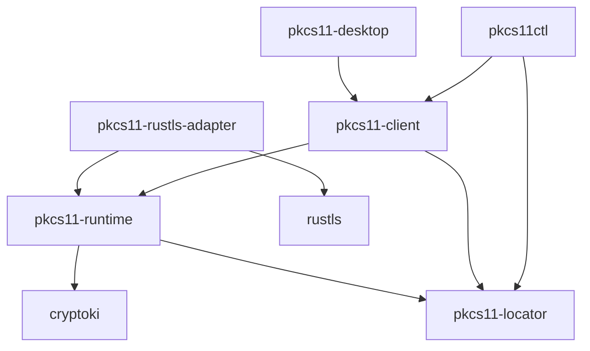

# pkcs11-stack

Rust libraries, CLI and desktop application for PKCS#11 tokens and hardware
security modules. Load a trusted vendor module, select keys and certificates with
PKCS#11 URIs, manage objects and perform cryptographic operations on the token.
The rustls adapter provides token-backed TLS client and server authentication.

## Build and run

| Component | Minimum Rust | Requirements |
| --- | --- | --- |
| Libraries and CLI | 1.85 | A trusted PKCS#11 module for token operations |
| Desktop and full workspace | 1.88 | Wayland on Linux; [native build dependencies](crates/pkcs11-desktop/README.md#build-and-run) |

```sh
cargo build --release -p pkcs11ctl --locked
./target/release/pkcs11ctl --help
./target/release/pkcs11ctl --module /absolute/path/to/trusted-pkcs11.so tokens
cargo run --release -p pkcs11-desktop --locked
```

Module paths load executable code and must come from a trusted source. A URI never
loads a library. Use stable token serials and object IDs; ambiguous matches fail.

## Crates

| Crate | Purpose |
| --- | --- |
| [pkcs11-locator](crates/pkcs11-locator/README.md) | Parse, build and match RFC 7512 URIs; binary IDs and PIN redaction |
| [pkcs11-runtime](crates/pkcs11-runtime/README.md) | Own modules, sessions and pools; discover resources and execute token operations |
| [pkcs11-client](crates/pkcs11-client/README.md) | Application workflows, certificate binding, public import/export and administration |
| [pkcs11ctl](crates/pkcs11ctl/README.md) | Command-line inspection, cryptography and token administration |
| [pkcs11-rustls-adapter](crates/pkcs11-rustls-adapter/README.md) | Token-backed rustls signing and certificate resolvers |
| [pkcs11-desktop](crates/pkcs11-desktop/README.md) | Native Iced token browser, cryptographic operations and object manager |

Direct dependencies:



Runtime owns initialization, sessions, authentication and mechanism planning.
Selectors identify persistent objects; raw handles stay within their sessions.
Applications choose the software crypto provider used by rustls for record
protection, key exchange and peer verification.

## Supported operations

The stack uses `cryptoki` 0.12.1 for PKCS#11 2.40, 3.0, 3.1 and 3.2. It supports
RSA/EC, AES, digest/MAC, ECDH/HKDF/SP 800-108, EdDSA, Montgomery, ML-DSA, ML-KEM,
SLH-DSA and hash-PQC operations. Availability depends on the token, provider and
application surface; see the [compatibility matrix](docs/oasis-compatibility.md).
Formal OASIS conformance and hardware compatibility are not implied.

Typed private/secret-key operations keep key material on the token. Authentication,
permissions, mechanism support and policy are checked before execution. Mutations
are not retried or rolled back; failures can leave persistent effects.

## Documentation and checks

Crate READMEs are also the library rustdoc landing pages. Build API documentation
and run checks from the repository root:

```sh
cargo doc --workspace --all-features --no-deps --locked
cargo fmt --all -- --check
cargo check --workspace --all-targets --locked
cargo clippy --workspace --all-targets --locked -- -D warnings
cargo test --workspace --locked
python3 tools/check-dependencies.py
```

- [Application examples](docs/examples.md): signing, certificate binding and TLS.
- [Provider tests](tests/README.md): disposable SoftHSM/Kryoptic setup and full-suite commands.
- [Fuzzing](fuzz/README.md): sanitizer runs, corpora and artifact replay.

## License

[MIT](LICENSE-MIT) OR [Apache-2.0](LICENSE-APACHE), at your option.
