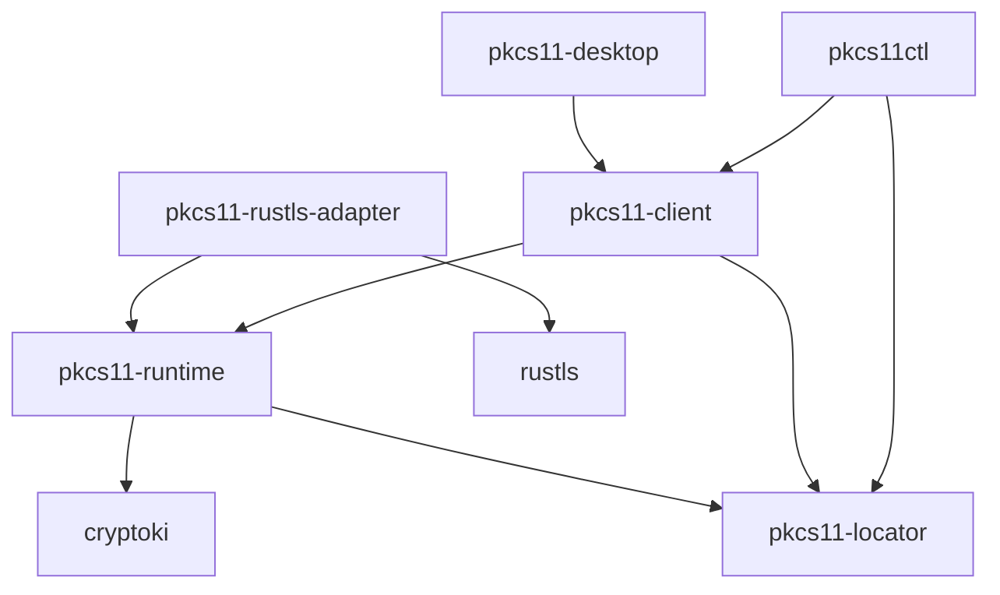

# pkcs11-stack

Rust libraries and tools for working with PKCS#11 tokens and hardware security
modules. Load a vendor module, find keys and certificates with PKCS#11 URIs,
manage token objects, and sign messages while keeping private keys on the token.

Applications can use `pkcs11-client` for synchronous discovery, signing and
administration. `pkcs11ctl` exposes those workflows from the command line. The
rustls adapter uses token keys for server and client TLS authentication, alongside
an application-selected software crypto provider.

## Architecture

Arrows show direct dependencies:



Runtime owns module initialization, sessions, authentication and mechanism
planning. Selectors identify persistent objects; raw handles stay within their
sessions. The client and CLI share application workflows. TLS-specific types and
software crypto provider selection stay outside runtime.

## Crates

- [pkcs11-locator](crates/pkcs11-locator/README.md): parse, build and match RFC 7512
  URIs, including binary object IDs and redacted PIN attributes.
- [pkcs11-runtime](crates/pkcs11-runtime/README.md): own modules and sessions,
  discover tokens and objects, pool sessions, plan signing and execute token operations.
- [pkcs11-client](crates/pkcs11-client/README.md): look up resources, inspect and
  manage objects, sign messages, and verify key/certificate associations.
- [pkcs11ctl](crates/pkcs11ctl/README.md): inspect modules and tokens, sign,
  manage keys and certificates, and administer token PINs from the command line.
- [pkcs11-rustls-adapter](crates/pkcs11-rustls-adapter/README.md): use token keys
  with rustls signing traits and server/client certificate resolvers.
- [pkcs11-desktop](crates/pkcs11-desktop/README.md): native Iced window with
  module loading, token browsing, metadata overviews and background execution.

## Status

The libraries and CLI implement discovery, USER/SO authentication, session pooling,
RSA PKCS#1 v1.5, RSA-PSS and ECDSA signing, certificate/data import and export,
signing-key generation, object deletion/relabeling, and token/PIN initialization
and changes. Certificate binding verifies that a selected private key matches a
certificate and checks each subsequent bound signature.

Runtime and client support pure ML-DSA-44/65/87 key generation, signing, token
verification and public-key SPKI export. Requests use explicit parameter sets,
contexts and hedging choices. The client also verifies signatures in software
and binds token private keys to ML-DSA certificates, checking each subsequent
bound signature. ML-DSA CLI commands and TLS integration are not implemented.

The TLS adapter supports server and mutual authentication with TLS 1.3 and optional
TLS 1.2. Supported signing keys are RSA and EC P-256/P-384/P-521; TLS use also
requires verification support from the application's crypto provider. See the
[signing and TLS examples](docs/examples.md) for runnable programs.

RSA-OAEP encryption/decryption supports SHA-2 with a matching MGF1 digest and
empty label. It processes one RSA block. Raw ECDH creates token-held generic
secrets on P-256/P-384/P-521; AES key wrapping and unwrapping use RFC 3394.
KDF application and private-key import are not implemented. Certificate parsing and binding do not validate
certificate trust; applications configure trust separately.

The desktop application loads and unloads modules, enumerates slots and tokens,
and browses visible objects and advertised mechanisms with filters and metadata
details. USER/SO login and logout support host PINs and token-protected
authentication paths. Refresh updates inventories and clears stale selections.
The GUI also generates signing key pairs, imports DER certificates, confirms
object deletion, exports public objects, signs files and verifies signatures
against selected certificates. It can also save bytes from a token's random
generator, encrypt/decrypt small RSA-OAEP payloads, derive ECDH secrets, and
wrap/unwrap AES keys with permitted keys. Administration supports confirmed token
initialization, USER PIN initialization/reset, and USER/SO PIN changes with host PINs.

## Development

Rust 1.85 or newer for libraries and CLI; Rust 1.88 or newer for desktop and
full workspace checks.

```sh
cargo fmt --all -- --check
cargo check --workspace --all-targets --locked
python3 tools/check-dependencies.py
cargo clippy --workspace --all-targets --locked -- -D warnings
cargo test --workspace --locked
cargo run -p pkcs11ctl -- --help
./tools/test-softhsm.sh
bash tools/test-fuzz.sh
```

The adapter's optional `tls12` feature enables TLS 1.2. Its default configuration
uses rustls `std` without selecting a software crypto provider.

Desktop uses Iced `tiny-skia`, `thread-pool`, `wayland`, `advanced` and
`linux-theme-detection`, with default features disabled. `iced_aw` enables only
`badge` and `spinner`. Linux requires Wayland.

[Test commands and configuration](tests/README.md) cover unit, property and
SoftHSM integration tests. [Fuzzing](fuzz/README.md) describes the separate fuzz workspace.

## License

The project is available under either the [MIT license](LICENSE-MIT) or the
[Apache License 2.0](LICENSE-APACHE), at your option.
