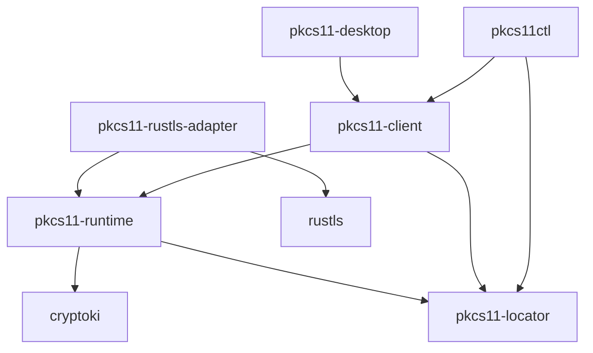

# pkcs11-stack

Rust libraries and tools for working with PKCS#11 tokens and hardware security
modules. Load a vendor module, find keys and certificates with PKCS#11 URIs,
manage token objects, and sign messages while keeping private keys on the token.

Applications can use `pkcs11-client` for synchronous discovery, signing and
administration. `pkcs11ctl` exposes those workflows from the command line. The
rustls adapter uses token keys for server and client TLS authentication, alongside
an application-selected software crypto provider.

## Architecture

Arrows show direct dependencies:



Runtime owns module initialization, sessions, authentication and mechanism
planning. Selectors identify persistent objects; raw handles stay within their
sessions. The client and CLI share application workflows. TLS-specific types and
software crypto provider selection stay outside runtime.

## Crates

- [pkcs11-locator](crates/pkcs11-locator/README.md): parse, build and match RFC 7512
  URIs, including binary object IDs and redacted PIN attributes.
- [pkcs11-runtime](crates/pkcs11-runtime/README.md): own modules and sessions,
  discover tokens and objects, pool sessions, plan signing and execute token operations.
- [pkcs11-client](crates/pkcs11-client/README.md): look up resources, inspect and
  manage objects, sign messages, and verify key/certificate associations.
- [pkcs11ctl](crates/pkcs11ctl/README.md): inspect modules and tokens, sign and verify,
  manage keys and certificates, and administer token PINs from the command line.
- [pkcs11-rustls-adapter](crates/pkcs11-rustls-adapter/README.md): use token keys
  with rustls signing traits and server/client certificate resolvers.
- [pkcs11-desktop](crates/pkcs11-desktop/README.md): native Iced window with
  module loading, token browsing, metadata overviews and background execution.

## Status

`pkcs11-stack` provides a typed Rust surface over PKCS#11 2.40, 3.0, 3.1 and 3.2
using published `cryptoki` 0.12.1. It covers module and token discovery, sessions,
authentication, object management, classical RSA/EC signing and encryption, AES,
ECDH/HKDF/SP 800-108, ML-DSA, ML-KEM, SLH-DSA, hash-PQC, EdDSA, Montgomery,
token-side verification and TLS client/server authentication. Private and secret
key material stays on the token.

The workspace is checked with formatting, compilation, Clippy, unit and
integration tests, documentation and dependency-boundary checks. Provider suites
run against unmodified SoftHSM 2.7.0 and pinned Kryoptic builds for ML-DSA,
ML-KEM, HKDF, SP 800-108, SLH-DSA, hash-PQC, EdDSA and Montgomery. The commands
and provider setup are in [tests/README.md](tests/README.md).

[The OASIS compatibility document](docs/oasis/compatibility.md) is the single
detailed list of supported mechanisms, operations and remaining upstream or
provider boundaries. This project does not claim formal OASIS conformance.

## Development

Rust 1.85 or newer for libraries and CLI; Rust 1.88 or newer for desktop and
full workspace checks.

```sh
cargo fmt --all -- --check
cargo check --workspace --all-targets --locked
python3 tools/check-dependencies.py
cargo clippy --workspace --all-targets --locked -- -D warnings
cargo run -p pkcs11ctl -- --help
./tools/test.sh
bash tools/test-fuzz.sh
```

The adapter's optional `tls12` feature enables TLS 1.2. Its default configuration
uses rustls `std` without selecting a software crypto provider.

Desktop uses Iced `tiny-skia`, `thread-pool`, `wayland`, `advanced` and
`linux-theme-detection`, with default features disabled. `iced_aw` enables only
`badge` and `spinner`. Linux requires Wayland.

[Test commands and provider setup](tests/README.md) cover the default suite,
including classical, PQC, hybrid and desktop integration tests.
[Fuzzing](fuzz/README.md) describes the separate fuzz workspace.

## License

The project is available under either the [MIT license](LICENSE-MIT) or the
[Apache License 2.0](LICENSE-APACHE), at your option.
