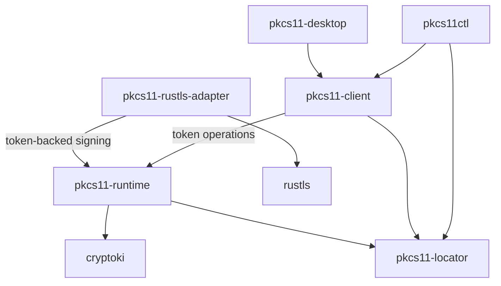

# pkcs11-stack

Use PKCS#11 tokens and hardware security modules from Rust, the terminal, or a
desktop app. Inspect and provision keys and certificates, run cryptographic
operations on a token, and use token-held keys for TLS authentication.

Use the [disposable SoftHSM quickstart](docs/quickstart.md) to generate a test
key, then sign and verify a message from the CLI and from Rust.

## Crates

| If you want to | Use |
| --- | --- |
| Integrate PKCS#11 into a Rust app. Start with this high-level API for token discovery, signing, and object management | [pkcs11-client](crates/pkcs11-client/README.md) |
| Inspect and administer a token by hand in a graphical interface | [pkcs11-desktop](crates/pkcs11-desktop/README.md) |
| Use a token from the terminal or automate workflows in scripts | [pkcs11ctl](crates/pkcs11ctl/README.md) |
| Authenticate a rustls server or mutual TLS client with a token-held key | [pkcs11-rustls-adapter](crates/pkcs11-rustls-adapter/README.md) |
| Control modules, sessions, pools, and typed mechanism operations directly | [pkcs11-runtime](crates/pkcs11-runtime/README.md) |
| Parse, build, or match RFC 7512 PKCS#11 URIs, with binary IDs and query-value redaction | [pkcs11-locator](crates/pkcs11-locator/README.md) |

## Build and run

| Component | Minimum Rust | Requirements |
| --- | --- | --- |
| Libraries and CLI | 1.88 | Trusted PKCS#11 module for token operations |
| Desktop and full workspace | 1.88 | Wayland to run the app on Linux and [native build dependencies](crates/pkcs11-desktop/README.md#build-and-run) |

### From a checkout

```sh
cargo build --release -p pkcs11ctl --locked
./target/release/pkcs11ctl --help
./target/release/pkcs11ctl --module /path/to/pkcs11.so tokens
```

Use an existing trusted module for `tokens` or follow the [SoftHSM setup](docs/quickstart.md#create-an-isolated-token).
For the desktop app, install the native dependencies above before running it.

```sh
cargo run --release -p pkcs11-desktop --locked
```

### After crates.io publication

The first planned release is `0.1.0`. Use these commands after publication.

```sh
cargo install --locked pkcs11ctl --version 0.1.0
pkcs11ctl --help
```

The library READMEs in the crate table show the dependency declarations for each example.

## Workspace crates and key dependencies



## Security and compatibility

- Load a trusted module explicitly. It runs native code in your process.
- Use stable token serials and binary object IDs for persistent selection.
  Operations that require one result reject ambiguous matches.
- Mechanism availability depends on the token and provider. The integration
  suites exercise software tokens. Validate physical devices with their vendor module.
- Key association and certificate trust are separate checks. See the
  [security model](docs/security-model.md) for authentication, cleanup, and key handling.

## Examples and documentation

- [Runnable signing and TLS examples](docs/examples.md)
- [Mechanism support by crate](docs/oasis-compatibility.md#application-surfaces)
- [Troubleshooting](docs/troubleshooting.md)

## Testing

Run from the repository root.

| Suite | Command | Setup |
| --- | --- | --- |
| Workspace tests and doctests | `cargo test --workspace --locked` or `./tools/test.sh --unit` | Native desktop build dependencies |
| Provider integration | `./tools/test.sh --providers` | [Disposable SoftHSM and Kryoptic setup](tests/README.md#full-provider-suite) |
| Both suites | `./tools/test.sh --all` | Same provider setup |
| Fuzzing | See the [fuzzing guide](fuzz/README.md) | Sanitizer runs, corpora, and artifact replay |

See the [test guide](tests/README.md) for coverage and provider prerequisites.

## Documentation and checks

The library READMEs also serve as rustdoc landing pages.

```sh
cargo doc --workspace --all-features --no-deps --locked
cargo fmt --all -- --check
cargo clippy --workspace --all-targets --locked -- -D warnings
```

## License

[MIT](LICENSE-MIT) OR [Apache-2.0](LICENSE-APACHE), at your option.

[Report a vulnerability](SECURITY.md)
