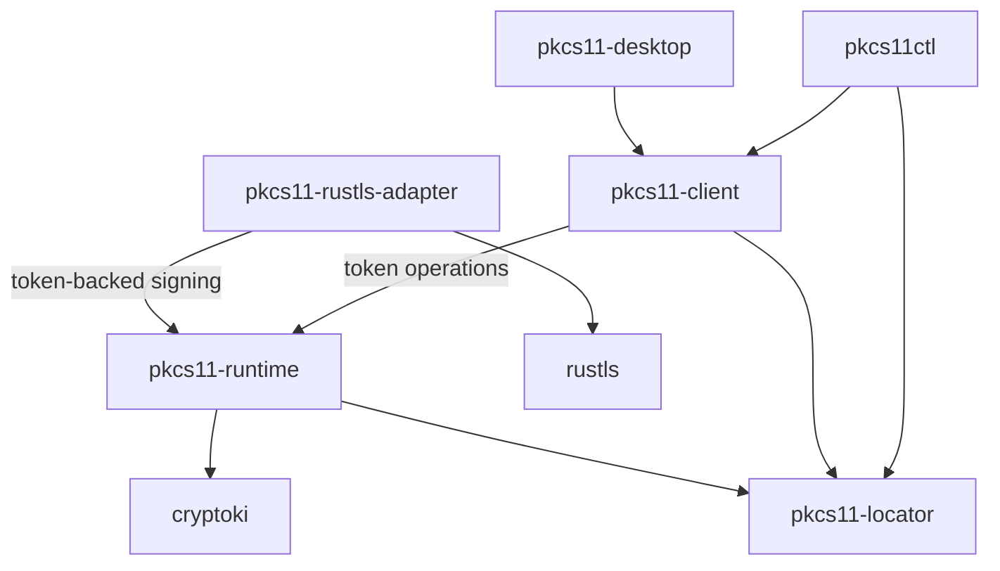

# pkcs11-stack

Rust libraries, CLI and desktop application for PKCS#11 tokens and hardware
security modules. Load a trusted vendor module, select keys and certificates with
PKCS#11 URIs, manage objects and perform cryptographic operations on the token.
The rustls adapter provides token-backed TLS client and server authentication.

## Build and run

| Component | Minimum Rust | Requirements |
| --- | --- | --- |
| Libraries and CLI | 1.85 | A trusted PKCS#11 module for token operations |
| Desktop and full workspace | 1.88 | Wayland on Linux; [native build dependencies](crates/pkcs11-desktop/README.md#build-and-run) |

```sh
cargo build --release -p pkcs11ctl --locked
./target/release/pkcs11ctl --help
./target/release/pkcs11ctl --module /absolute/path/to/trusted-pkcs11.so tokens
cargo run --release -p pkcs11-desktop --locked
```

Module paths load executable code and must come from a trusted source. A URI never
loads a library. Use stable token serials and object IDs; ambiguous matches fail.

## Crates

| Crate | Purpose |
| --- | --- |
| [pkcs11-locator](crates/pkcs11-locator/README.md) | Parse, build and match RFC 7512 URIs; binary IDs and query-value redaction |
| [pkcs11-runtime](crates/pkcs11-runtime/README.md) | Own modules, sessions and pools; discover resources and execute token operations |
| [pkcs11-client](crates/pkcs11-client/README.md) | Application workflows, certificate binding, public import/export and administration |
| [pkcs11ctl](crates/pkcs11ctl/README.md) | Command-line inspection, cryptography and token administration |
| [pkcs11-rustls-adapter](crates/pkcs11-rustls-adapter/README.md) | Token-backed rustls signing and certificate resolvers |
| [pkcs11-desktop](crates/pkcs11-desktop/README.md) | Native Iced token browser, cryptographic operations and object manager |

Direct production dependencies



The runtime owns the PKCS#11 lifecycle and executes token operations. Its internal
modules follow operation families such as signing, encryption, key establishment
and derivation. The client composes those operations into application workflows.
Library callers use the crate-root exports.
Applications choose the software crypto provider used by rustls for record
protection, key exchange and peer verification.

## Supported operations

Available operations depend on the token and provider. See the
[PKCS#11 compatibility matrix](docs/oasis-compatibility.md) for supported
mechanisms and where each is available. The
[security model](docs/security-model.md) explains which protections depend on
the provider or application.

## Documentation and checks

Keep `mod.rs` files declaration-only across library, application, example, and
test code. They contain external module declarations and re-exports, with
optional comments and attributes. Put implementations in named sibling files.
Reviewers check this convention during code review.

Crate READMEs are also the library rustdoc landing pages. Build API documentation
and run checks from the repository root:

```sh
cargo doc --workspace --all-features --no-deps --locked
cargo fmt --all
cargo clippy --workspace --all-targets --locked -- -D warnings
cargo test --workspace --locked
```

Run `./tools/test.sh --providers` for the provider suites or
`./tools/test.sh --all` for both, after setting up the providers.

- [Application examples](docs/examples.md): signing, certificate binding and TLS.
- [Provider tests](tests/README.md): disposable SoftHSM/Kryoptic setup and full-suite commands.
- [Fuzzing](fuzz/README.md): sanitizer runs, corpora and artifact replay.
- [Development and release checks](docs/development.md): dependency boundaries, audits and package review.

## License

[MIT](LICENSE-MIT) OR [Apache-2.0](LICENSE-APACHE), at your option.

[Report a vulnerability](SECURITY.md) · [Changelog](CHANGELOG.md)
